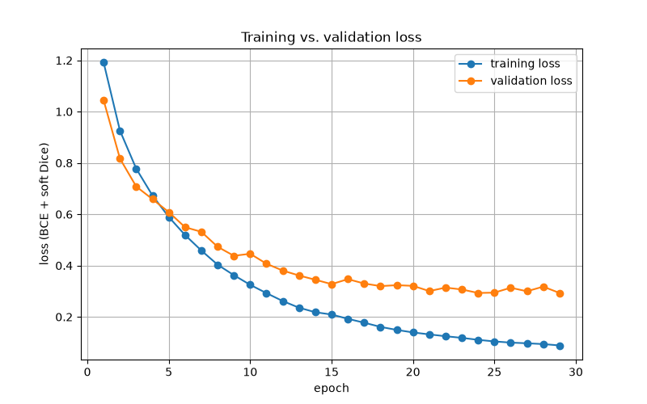
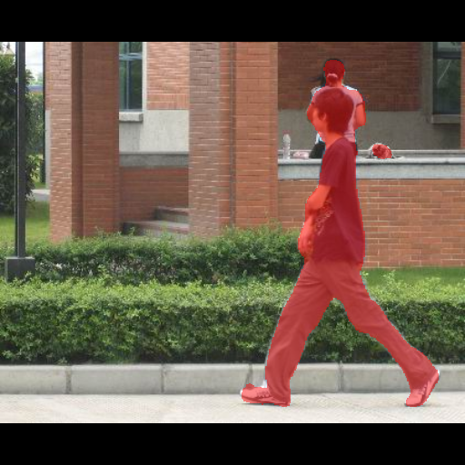
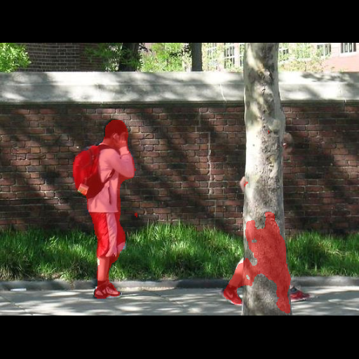

# Pedestrian Segmentation

A pipeline that trains a pedestrian segmentation model without hand-drawing masks from scratch. Foundation models produce the first labels, a person reviews them in CVAT, starting from the images most likely to be wrong, and a small U-Net is trained on the reviewed set.

## Pipeline

```
Penn-Fudan images ──► Grounding DINO (boxes) ──► SAM (masks) ──► COCO polygons
                                                                      │
                     triage ranking ◄─────────────────────────────────┤
                           │                                          ▼
                           └──────────────► manual review in CVAT ──► reviewed COCO
                                                                      │
                     split by source image ◄──────────────────────────┘
                           │
                           ▼
                     augmentation ──► U-Net (ResNet-18 encoder) ──► Dice / IoU, overlays
```

1. **Download** (`pipeline/download_dataset.py`). The 170 images of the [Penn-Fudan pedestrian dataset](https://www.cis.upenn.edu/~jshi/ped_html/) go to `data/raw/images`. The dataset's own masks are not used: the labels are produced by the pipeline.
2. **Automatic labels** (`pipeline/auto_label.py`). Grounding DINO (`grounding-dino-tiny`), an open-vocabulary detector, finds boxes for the text prompt "pedestrian." (box threshold 0.35, text threshold 0.25). Each box is a prompt for SAM (`sam-vit-base`), which returns three candidate masks; the one with the highest predicted IoU is kept. Masks are turned into simplified polygons with OpenCV, small fragments are dropped, and the result is a COCO file: 506 pedestrian instances on 170 images (`data/annotations/auto_labels_coco.json`).
3. **Review triage** (`pipeline/annotation_triage.py`). Reviewing every image is slow, so each image gets five suspicion signals: how far its instance count is from the median, its smallest instance area, its most extreme polygon vertex count, its widest box (a pedestrian is normally taller than wide) and its least convex polygon (solidity, the area of a polygon over the area of its convex hull). Images are ranked by each signal, and an image's priority is its best rank across the signals, so an image that is extreme on any one of them comes first. The output is a CSV with the CVAT frame number and the signal that put each image there.
4. **Manual review in CVAT.** 45 images, taken in triage order, were corrected by hand: 265 reviewed instances in `data/reviewed/annotations/instances_default.json`. CVAT sometimes saves a corrected object as a mask instead of a polygon; `pipeline/convert_masks_to_polygons.py` converts those back (13 in this review).
5. **Split and augmentation** (`pipeline/augment.py`). The reviewed images are split 31 / 7 / 7 into training, validation and test sets by source image, before augmentation, so augmented copies of one photo never land in two sets. Every image is resized by its longest side to 512 pixels and padded with black to a square, which keeps the proportions of people instead of stretching them. Each training image gets 4 augmented copies (horizontal flip, affine scale, shift and rotation, brightness and contrast, Gaussian noise); the validation and test images are only resized and padded.
6. **Training** (`pipeline/train_unet.py`). A U-Net from `segmentation-models-pytorch` with a ResNet-18 encoder pretrained on ImageNet, input 384 × 384, trained with Adam (learning rate 1e-4, batch 4) on binary cross-entropy plus soft Dice loss. Early stopping ends training after 5 epochs without a lower validation loss, and the saved checkpoint is the epoch with the best validation Dice. The test set is evaluated once, after the checkpoint is chosen.
7. **Inspection** (`pipeline/predict_and_visualize.py`, `pipeline/plot_training_curves.py`). Predicted masks are drawn over the test images, and the loss curves of the latest run are plotted from the log.

## Results

The final run stopped early after 29 of 30 epochs; the best validation epoch was 25.

| Set | Images | Dice | IoU |
|---|---|---|---|
| Validation (best epoch) | 7 | 0.886 | 0.795 |
| Test | 7 | 0.897 | 0.814 |



The validation loss levels off at about 0.3 from epoch 15 on while the training loss keeps falling, so most of what the model can learn from 31 images is learned by then.

The augmentations and the batch order are not seeded, so runs differ. A rerun of the same pipeline reached a best validation Dice of 0.882 (epoch 9) and a test Dice of 0.875 (IoU 0.779): on 7 test images the spread between runs is about two points of Dice.

The previous run stretched the images to a square instead of padding them, used a 256 × 256 input and binary cross-entropy alone. Its best validation Dice was 0.891, close to the final run, so on 7 validation images the change from stretching to padding cannot be shown to help or hurt; the change was kept because it does not distort the shapes of people.

| Typical result | Typical error |
|---|---|
|  |  |

On the right, the person behind the tree is correctly found at the legs, but the model also paints part of the trunk: an occluded pedestrian and a vertical object of similar width are confused. More reviewed images with occlusion would be the first fix.

## Running

The service runs in Docker with an NVIDIA GPU (`compose.yaml`); the image downloads the Grounding DINO and SAM weights at build time. Without a GPU every step falls back to the CPU; the runs above were trained on a CPU in about 25 minutes.

```
docker compose up -d --build
docker compose exec cv-object-detection python3 -m pipeline.download_dataset
docker compose exec cv-object-detection python3 -m pipeline.auto_label
docker compose exec cv-object-detection python3 -m pipeline.annotation_triage data/annotations/auto_labels_coco.json data/annotations/review_priority.csv
```

Import `auto_labels_coco.json` into CVAT, review the images in the order of `review_priority.csv`, export the task as COCO 1.0 into `data/reviewed/annotations/` and put the reviewed images into `data/reviewed/images/`. If the export contains masks, convert them first:

```
docker compose exec cv-object-detection python3 -m pipeline.convert_masks_to_polygons <exported.json> data/reviewed/annotations/instances_default.json
docker compose exec cv-object-detection python3 -m pipeline.augment
docker compose exec cv-object-detection python3 -m pipeline.train_unet
docker compose exec cv-object-detection python3 -m pipeline.predict_and_visualize
docker compose exec cv-object-detection python3 -m pipeline.plot_training_curves data/logs/pipeline.log data/predictions/loss_curve.png
```

All paths, model names, thresholds and training settings are in `pipeline/segmentation_settings.py`.

## Code quality

The code is checked with `python -m pycodestyle --max-line-length=88 pipeline`, `python -m pyright` (strict, with local stubs in `typings/` for `transformers`, `albumentations`, `segmentation_models_pytorch`, `pycocotools.mask` and the parts of `matplotlib` the pipeline uses) and the AST checker [tools/rules_check.py](tools/rules_check.py) (`python tools/rules_check.py .`): at most 10 statements per function, no magic numbers outside `segmentation_settings.py`, type hints on containers, no abbreviations or single-letter names, ordered imports.
